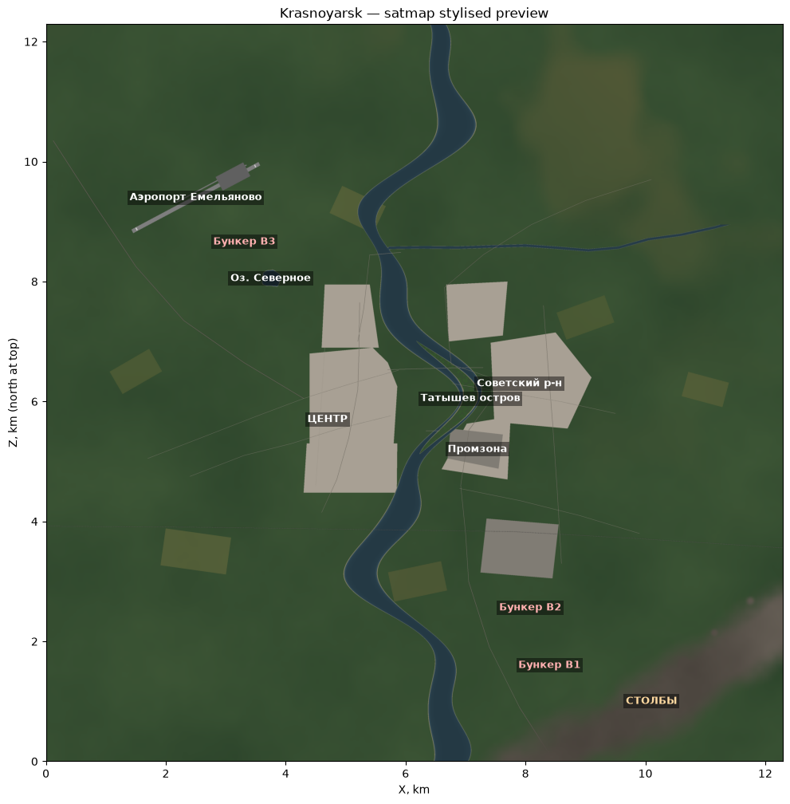

# Krasnoyarsk — кастомная карта для DayZ 1.30

Неофициальный фанатский проект: **12 × 12 км** стилизованной карты «Красноярск»
для DayZ, по мотивам Намальска/Deer Isle. Енисей через центр, остров Татышев,
Столбы на юго-востоке, Емельяново на северо-западе, город по обоим берегам,
заготовки под бункеры, лут и спавны для центральной экономики уже расставлены.

> **Честное предупреждение (прочитайте до начала).**
> Финальная сборка карты (.wrp → .pbo) возможна **только на Windows с DayZ + DayZ Tools**.
> В этом репозитории — полные исходники рельефа/земли, генератор, конфиги, миссия,
> серверные примеры и подробные инструкции (на русском). «Дома и деревья» ставите вы сами.
> Карта стилизованная, а не геодезическая копия города.



## Что внутри

```
source/                 — всё для Terrain Builder: heightmap.asc/.png, satmask.png,
                          satmap.png, maplegend.png, layers.cfg (пути — на ванильные DZ\...)
tools/generate_terrain.py — детерминированный генератор (numpy/pillow/matplotlib)
previews/               — отмывка рельефа, сателлит и маска с подписями
mod/                    — mod.cpp для папки @KrasnoyarskMap + шаблоны 3 аддонов
                          (world/data/navmesh) с готовыми config.cpp
mission/dayzOffline.krasnoyarsk/ — сгенерированные cfgeventspawns.xml и
                          cfgplayerspawnpoints.xml + инструкция
server/                 — образцы serverDZ.cfg и стартового .cmd
docs/                   — пошаговые инструкции на русском (начните с docs/01-overview.md)
```

## Маршрут «за 4–8 часов»

1. **DayZ Tools** (Steam) + DayZ — смонтируйте диск **P:** (`DayZ Tools → Tools → Workbench`).
2. Скопируйте `source\` в `P:\Krasnoyarsk\source\` (см. `docs/04-terrain-builder.md`).
3. В **Terrain Builder** импортируйте `heightmap.asc` → `satmask.png` → `satmap.png`,
   Rebuild Terrain, Generate Layers, экспорт `P:\Krasnoyarsk\world\Krasnoyarsk.wrp`.
4. Скопируйте `mod/addon_templates/world/config.cpp` в `P:\Krasnoyarsk\world\`,
   создайте `$PBOPREFIX$` (см. `mod/addon_templates/README.md`).
5. Соберите 3 PBO (**RaG PBO Builder** или Mikero), подпишите ключом
   `DSCreateKey.exe Krasnoyarsk` → получите `@KrasnoyarskMap` (см. `docs/06-pbo-build.md`).
6. Сервер: миссия `dayzOffline.chernarusplus` → копия `dayzOffline.krasnoyarsk` +
   наши `cfgeventspawns.xml`/`cfgplayerspawnpoints.xml`; `template` в `serverDZ.cfg`;
   `-mod=@KrasnoyarskMap`; `Krasnoyarsk.bikey` в `keys\` (см. `docs/07-server.md`).

## Документация

| Шаг | Файл |
|---|---|
| Что это и что НЕ входит | [docs/01-overview.md](docs/01-overview.md) |
| Требования (Windows, DayZ, Tools, P: диск) | [docs/02-requirements.md](docs/02-requirements.md) |
| Пересборка исходников скриптом | [docs/03-generate-sources.md](docs/03-generate-sources.md) |
| Terrain Builder: импорт и сборка мира | [docs/04-terrain-builder.md](docs/04-terrain-builder.md) |
| Объекты, navmesh, производительность | [docs/05-world-setup.md](docs/05-world-setup.md) |
| PBO + ключи | [docs/06-pbo-build.md](docs/06-pbo-build.md) |
| Сервер, приватность, «только для своего сервера» | [docs/07-server.md](docs/07-server.md) |
| Бункеры и подземные помещения | [docs/08-bunkers.md](docs/08-bunkers.md) |
| Координаты всех ключевых точек | [docs/09-coordinates.md](docs/09-coordinates.md) |
| FAQ / типичные ошибки | [docs/10-faq.md](docs/10-faq.md) |
| Настоящие геоданные (QGIS + SRTM) | [docs/11-advanced-geo.md](docs/11-advanced-geo.md) |
| Кредиты и лицензии | [docs/credits.md](docs/credits.md) |

## Главные вопросы — короткие ответы

**«Карта будет только на моём сервере?»** — Да, если не публиковать в Steam Workshop
(или публиковать как Friends Only / Unlisted). У каждого игрока всё равно должна быть
копия мода — так устроен DayZ, обойти нельзя (см. `docs/07-server.md`).

**«PBO собрать у себя нельзя?»** — Нет, только на Windows с DayZ Tools. Здесь собрана
вся «сырая» часть + инструкции до рабочего мода.

**«Река и рельеф готовы?»** — Да: русло Енисея (−3.1 м), остров, приток Кача,
озеро Северное, Столбы с останцами, городские террасы, 3 бункерные ямы.
Дома/деревья — за вами.

**DayZ 1.30?** — Да. Конфиги и форматы (CfgWorlds/CE XML, ocean .emat) соответствуют
актуальному пайплайну кастомных террейнов DayZ.
